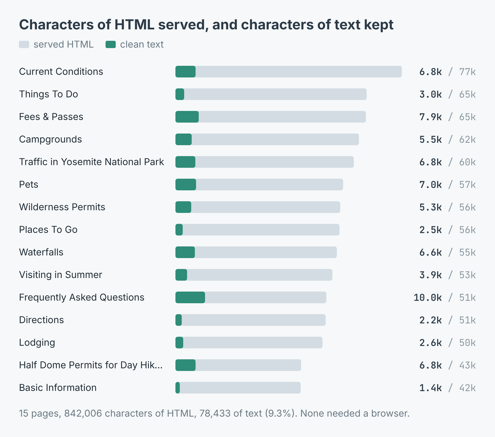
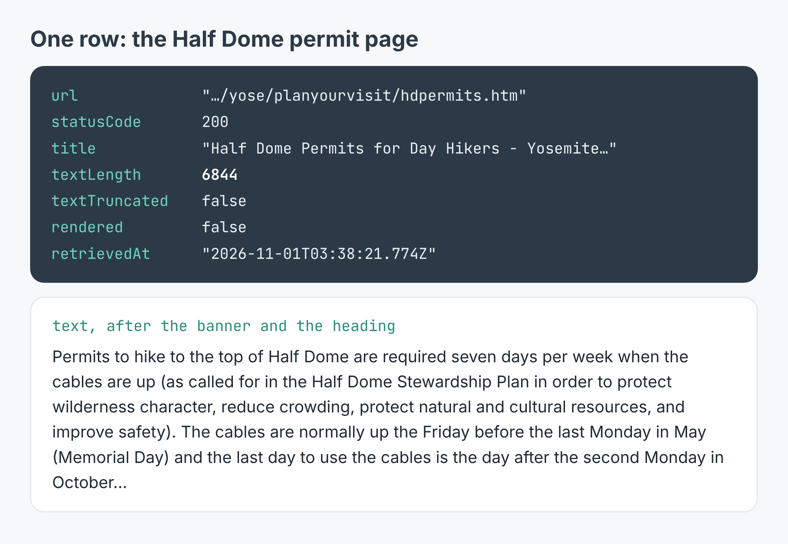

# Website to text for an LLM: a site's pages as one clean text file

Give it a website's start page and a pattern for the link text you care about
(`"fees|permits"`, `"pricing|billing"`). It lists the start page's links to
the same site with the words that were clickable, reads the pages whose words
match, strips the menus, scripts, headers and footers, drops the sentences
that repeat on every page, and writes the lot to one `site.txt`, ready to
paste into a language model or load into a retrieval index.

These scripts call [Web Page Text Scraper](https://apify.com/simple.actor/page-text-reader)
on Apify. No browser setup is needed: it opens one only for a page whose
served HTML doesn't hold the text.



The write-up, with a real run on 15 pages of Yosemite National Park's site, is
[How to turn a website into clean text for an LLM](https://simple-actor.github.io/website-clean-text-for-llm-yosemite/)

## Run it

You need an [Apify](https://apify.com) account and its API token, from
Console → Settings → API & Integrations.

**Node** (20 or newer):

```bash
cd node
npm install
APIFY_TOKEN=your_token node site-to-text.mjs https://www.nps.gov/yose/index.htm "fees|permits"
```

**Python** (3.10 or newer):

```bash
cd python
python -m venv .venv && . .venv/bin/activate
pip install -r requirements.txt
APIFY_TOKEN=your_token python site_to_text.py https://www.nps.gov/yose/index.htm "fees|permits"
```

The first argument is the start page, the second a case-insensitive pattern
matched against each link's anchor text (default: every link), the third the
most pages to read (default 20). Links to images and PDFs are skipped. The
output on 1 November 2026:

```
50 links on the start page, 3 match /fees|permits/
  7875 ->   7436 chars  Fees & Passes - Yosemite National Park (U.S. National Park Service)
  5337 ->   4898 chars  Wilderness Permits - Yosemite National Park (U.S. National Park Service)
  6844 ->   6405 chars  Half Dome Permits for Day Hikers - Yosemite National Park (U.S. National Park Service)
3 pages, 17 repeated sentences dropped, 19138 chars in site.txt
```

The repeated sentences are only dropped when three or more pages were read;
with fewer, a sentence on every page may still be the page.

## What a row looks like

[`sample-output.json`](sample-output.json) holds four real rows: Yosemite's
home page in discover mode, with its 50 links, and the Half Dome permits,
fees and basic information pages in text mode. The run asked for the raw HTML
too; it is left out of the sample for size.



The fields you will use most:

| Field | What it holds |
|---|---|
| `text` | The page's visible prose in full, headings and paragraphs ending in a full stop |
| `textLength`, `textTruncated` | Its length, and whether it went past the 50,000-character limit |
| `title`, `loadedUrl`, `statusCode` | The page's `<title>`, where it was read from after redirects, its HTTP status |
| `links` | Discover mode only: `{ url, anchor }` for every same-site link, in page order |
| `rendered` | Whether a browser was needed |
| `error`, `errorDescription` | Only on a page that could not be read, which then has **no** `text` key |

Key on whether a row **has** `text`, not on whether it's empty: `text: ""`
is a page that loaded with nothing on it, a missing `text` is a page that was
never read.

## Cost

$0.002 for each page read, $2.00 per 1,000, plus $0.00005 a run. A page that
could not be read is not charged; a 404 is. The 15 Yosemite pages cost
$0.03005 and the discover run before them $0.00205. Each run of these scripts
is two runs of the scraper: one page in discover mode, then the pages that
matched.

## Limits

- **Site furniture that isn't navigation stays in.** On nps.gov, 17 sentences
  (the .gov banner, an "Exiting nps.gov" notice, the park footer) came back on
  every page, about 439 characters a page. The scripts drop them; the raw rows
  keep them.
- **Not typeset prose.** A link at the end of a sentence can leave a space
  before the full stop, and the odd heading runs into its paragraph.
- **Discover lists every same-site link,** photos and site-wide policy pages
  included. Filter before reading.
- **It doesn't crawl.** It reads the start page and the pages you pick from
  its links, one level deep.
